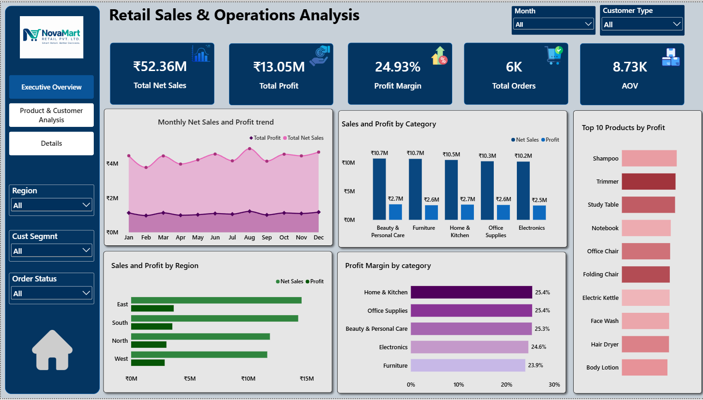

# 🛍️ Client Retail Sales Dashboard | Power BI

## 📌 Project Overview

The **Client Retail Sales Dashboard** is an interactive Power BI project designed to analyze retail sales performance, profitability, customer behavior, product performance, and order trends.

The dashboard transforms retail transaction data into meaningful business insights, helping stakeholders monitor sales, evaluate profitability, identify high-performing products, and understand customer and order patterns.

## 🎯 Business Objectives

The main objectives of this project are to:

- Monitor overall retail sales and profit performance.
- Analyze sales and profitability across different product categories.
- Identify products generating high sales but low or negative profit.
- Understand customer segments and customer types.
- Analyze order status and delivery performance.
- Compare sales performance across regions and sales channels.
- Track monthly sales and profit trends.

## 🛠️ Tools & Technologies

- **Microsoft Power BI** — Dashboard development and visualization
- **Power Query** — Data cleaning and transformation
- **DAX** — KPI calculations and business measures
- **Data Modeling** — Organizing retail data for analysis
- **Interactive Reporting** — Drill-through and report navigation

## 📂 Dataset Information

The project uses a retail dataset stored in the `retail_clients` table.

The dataset contains information about orders, customers, products, sales, discounts, profit, shipping, and delivery.

**Important columns include:**

- `order_id`
- `order_date`
- `ship_date`
- `city`
- `state`
- `region`
- `zone`
- `customer_id`
- `cust_segmnt`
- `category`
- `product_name`
- `quantity`
- `unit_price`
- `discount`
- `gross_sales`
- `discount_amt`
- `net_sales`
- `prod_cost`
- `shipping_cost`
- `profit`
- `payment_method`
- `sales_channel`
- `order_status`
- `returned`
- `delivery_status`
- `customer_age`
- `promised_date`
- `customer_type`
- `cust_rating`
- `age_group`

A calendar table named `Calender Date` is also used for date-based analysis.

## 📊 Key Performance Indicators (KPIs)

The dashboard includes the following DAX measures:

| KPI | Description |
|---|---|
| Total Net Sales | Total sales after discounts |
| Total Profit | Total profit generated |
| Total Orders | Distinct count of order IDs |
| Profit Margin | Total Profit / Total Net Sales |
| AOV | Average Order Value |
| High Sales Low Profit | Identifies products with above-average sales and zero or negative profit |

## 📈 Dashboard Pages

### 1. Executive Overview

Provides a high-level summary of overall retail business performance.

**Key analytical areas:**
- Total Net Sales
- Total Profit
- Total Orders
- Profit Margin
- Average Order Value (AOV)
- Monthly sales and profit trends
- Regional sales performance
- Category-wise sales and profitability
- Order status and customer segment analysis

### 2. Product & Customer Analysis

Focuses on product-level profitability and customer behavior.

**Key analytical areas:**
- Product-wise sales and profit
- Category-wise performance
- High Sales / Low Profit product identification
- Discount impact on profitability
- Customer segment analysis
- Customer type distribution
- Sales channel performance

### 3. Details

Provides a detailed view of product performance through a drill-through page.

**Key analytical areas:**
- Product Name
- Total Orders
- Total Net Sales
- Total Profit
- Profit Margin
- Average Order Value

This page allows users to explore detailed product performance based on the selected context from other report pages.

## 🔍 Interactive Features

- Date-based analysis
- Region-wise filtering
- Product and category analysis
- Customer segment and customer type filtering
- Order status and sales channel analysis
- Product-level drill-through
- Interactive cross-filtering between visuals

## 💡 Business Questions Explored

This dashboard is designed to answer important retail business questions:

1. What are the total net sales and total profit?
2. Which product categories generate the highest sales?
3. Which categories or products generate low or negative profit?
4. Which products have high sales but low or negative profitability?
5. How does discounting relate to product profitability?
6. Which regions contribute the most to net sales?
7. How do sales and profit change month over month?
8. Which customer segments contribute to sales?
9. How are orders distributed across different order and delivery statuses?
10. Which sales channels contribute to overall revenue?

## 💼 Business Value

The dashboard demonstrates how retail transaction data can support:

- Sales performance monitoring
- Product and category profitability analysis
- Identification of high-sales, low-profit products
- Customer segment analysis
- Regional performance comparison
- Order and delivery monitoring
- Better data-driven business decisions

These are potential business applications of the analysis, rather than claims of verified financial improvements.

## 🧠 Skills Demonstrated

- Data cleaning and transformation
- Power Query
- DAX measure creation
- Data modeling
- KPI development
- Sales and profitability analysis
- Customer segmentation
- Product performance analysis
- Drill-through reporting
- Interactive dashboard development

## 📷 Dashboard Preview

Add screenshots of your actual Power BI dashboard to the repository.

### Executive Overview

### Product & Customer Analysis

### Details

## 📁 Project Files

- `Client-Retail-Dashboard.pbit` — Power BI report template
- `README.md` — Project documentation
- `screenshots/` — Dashboard preview images

## 🚀 Project Outcome

This project demonstrates practical skills in analyzing retail business data using Power BI, Power Query, and DAX.

It showcases how interactive dashboards can help stakeholders understand sales performance, monitor profitability, explore customer behavior, and identify potential business opportunities.

This project is part of my ongoing journey to develop practical data analytics skills and build my Data Analyst portfolio.

**Feedback and suggestions are welcome!**
