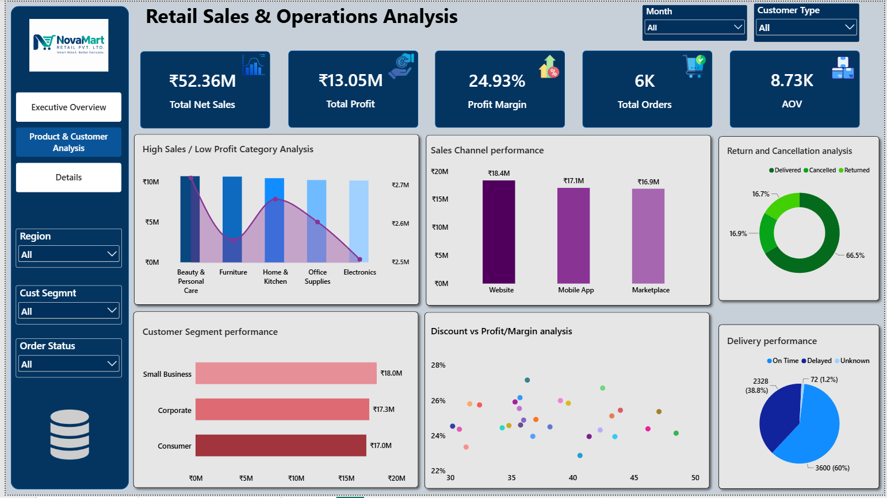
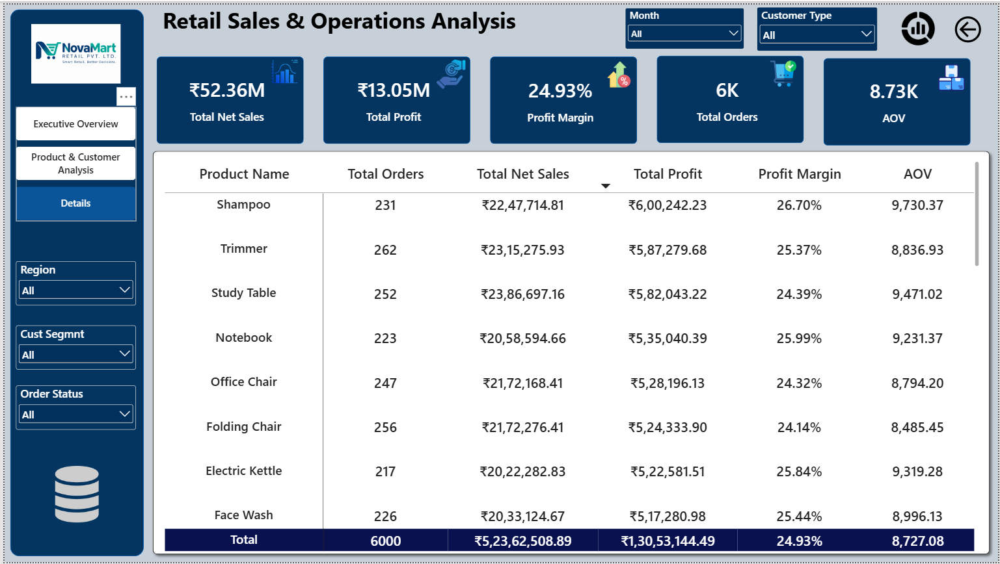

# 🛍️ Client Retail Sales Dashboard | Power BI

**Tools:** Python | Pandas | MySQL | Power BI | Power Query | DAX

## 📌 Project Overview

This is an end-to-end retail data analytics project based on a business case for **NovaMart Retail Pvt. Ltd.**, covering the reporting period January–December 2025.

The project started with a raw CSV export from a retail order management system. The objective was to transform unprepared data into a reliable analytical dataset, perform SQL-based business analysis, and develop an interactive Power BI dashboard to support management decision-making.

I completed the project through three major stages:

1. **Python & Pandas:** Data profiling, cleaning, validation, and preparation.
2. **MySQL:** Business-focused SQL analysis to answer key management questions.
3. **Power BI:** Data modeling, DAX calculations, KPI development, and interactive dashboard creation.

The analysis focuses on sales performance, profitability, product and category performance, customer segments, sales channels, discounts, returns, cancellations, and delivery performance.

## 🎯 Business Problem

Management could monitor total sales in the system but lacked a clear understanding of what was actually driving revenue and profit.

The business needed answers to questions such as:

- Where is the company making money, and where is it losing money?
- Which products and categories need management attention?
- Are discounts helping sales or hurting profitability?
- Which regions, customer segments, and sales channels perform best?
- How are returns and cancellations affecting business performance?
- Is delivery performance affecting the overall business?

The purpose of this project was to turn raw transactional data into meaningful business insights that could help management investigate these areas.

## 🛠️ Tools & Technologies

| Tool / Technology | Purpose |
|---|---|
| Python | Raw data inspection, cleaning, and validation |
| Pandas | Data manipulation and preprocessing |
| MySQL | SQL-based business analysis |
| Microsoft Power BI | Interactive dashboard development |
| Power Query | Data transformation |
| DAX | KPI calculations and analytical measures |
| Data Modeling | Organizing data for reporting and analysis |

## 🔄 End-to-End Project Workflow

### 1. Data Profiling, Cleaning & Preparation – Python

Used Python and Pandas to inspect and clean the raw CSV before performing business analysis.

**Key activities:**

- Checked dataset dimensions, column names, and data types.
- Identified missing values and duplicate records.
- Inspected completely blank rows.
- Standardized column names for SQL and Power BI.
- Identified unnecessary or redundant columns.
- Corrected numeric and date data types.
- Handled missing values using appropriate methods rather than blindly replacing nulls with zero.
- Standardized inconsistent text values and removed unwanted spaces.
- Checked invalid values, including abnormal discount values, impossible ages, and invalid dates.
- Checked duplicate Order IDs and duplicate records.
- Prepared the final cleaned CSV for further analysis.
- Maintained a data-cleaning log to document changes.

**Tools:** Python, Pandas, Jupyter Notebook / Google Colab.

### 2. SQL-Based Business Analysis – MySQL

Imported the cleaned dataset into MySQL and performed business-focused analysis to answer the client's questions.

**SQL concepts used:**

- SELECT, WHERE and ORDER BY
- Aggregate functions
- GROUP BY and HAVING
- CASE statements
- JOIN operations
- Subqueries
- Common Table Expressions (CTEs)
- Window Functions
- Date-based analysis
- Month-over-Month (MoM) growth calculations
- Ranking and profitability analysis

**Business analysis performed:**

1. Calculated total orders, quantity, net sales, and profit.
2. Analyzed monthly sales and profit trends.
3. Identified categories generating the highest sales and profit.
4. Identified high-sales but low/negative-profit products.
5. Compared sales and profit across regions.
6. Analyzed profitability by customer segment.
7. Compared sales channels by sales, orders, and profit.
8. Examined the relationship between discount levels and profit margins.
9. Identified products receiving the highest average discounts.
10. Analyzed return rates by product and category.
11. Compared cancelled, returned, and delivered orders.
12. Calculated the percentage of delayed deliveries.
13. Identified regions with the highest delayed-delivery rates.
14. Identified the top 10 customers by net sales.
15. Investigated customers with high sales but unusually low profit.
16. Identified the top 10 products by profit.
17. Ranked the top 3 products by profit within each category using window functions.
18. Calculated month-over-month sales growth.
19. Analyzed profit margins by category and region.
20. Identified business areas requiring further investigation.

### 3. Dashboard Development – Power BI

Used the cleaned and analyzed retail data to build an interactive, management-facing Power BI dashboard.

**Key activities:**

- Prepared and organized data for reporting.
- Created data models and relationships.
- Developed DAX measures for business KPIs.
- Designed KPI cards and analytical visuals.
- Created category, region, product, and customer analysis.
- Developed profitability and discount-related analysis.
- Added interactive filters and report navigation.
- Created a product-level details page for deeper analysis.

## 📊 Key Performance Indicators (KPIs)

The project uses the following business KPIs:

| KPI | Business Meaning |
|---|---|
| Total Net Sales | Overall revenue after discounts |
| Total Profit | Profit after product and shipping costs |
| Profit Margin % | Profit as a percentage of net sales |
| Total Orders | Count of valid orders |
| Total Quantity | Total units sold |
| Average Order Value (AOV) | Net sales divided by total orders |
| Average Discount % | Average discount applied to orders |
| Return Rate % | Returned orders as a percentage of relevant orders |
| Cancellation Rate % | Cancelled orders as a percentage of orders |
| On-Time Delivery % | On-time deliveries as a percentage of delivered orders |

## 📈 Power BI Dashboard Pages

### 1. Executive Overview

Provides management with a high-level summary of retail business performance.

**Key analytical areas:**
- Total Net Sales, Total Profit, Profit Margin, Total Orders, and AOV.
- Monthly Net Sales and Profit trends.
- Sales and Profit by Category.
- Sales and Profit by Region.
- Profit Margin by Category.
- Top 10 Products by Profit.
- Sales Channel performance.
- Customer Segment performance.

### 2. Product & Customer Analysis

Focuses on understanding product profitability, customer behavior, and factors influencing business performance.

**Key analytical areas:**
- Product and category performance.
- High Sales / Low Profit product analysis.
- Discount versus Profit / Profit Margin analysis.
- Customer Segment performance.
- Customer Type analysis.
- Product-level profitability comparison.

### 3. Details

Provides a more detailed view of product-level performance to support further investigation.

**Key analytical areas:**
- Product Name.
- Total Orders.
- Total Net Sales.
- Total Profit.
- Profit Margin.
- Average Order Value.

## 🔍 Dashboard Filters & Interactivity

The project supports business-focused filtering and exploration using relevant report filters, including:

- Date / Month
- Region
- Category
- Customer Segment
- Sales Channel
- Order Status
- Customer Type
- Product Name

Interactive visuals allow users to explore different dimensions of retail performance.

## 💡 Key Business Areas Investigated

The analysis focuses on identifying potential business opportunities and operational concerns:

- **Profitability:** Products and categories generating high sales but low or negative profit.
- **Discount Strategy:** How different discount levels relate to profit margins.
- **Regional Performance:** Differences in sales and profitability across regions.
- **Customer Analysis:** Customer segments and customers contributing to sales and profit.
- **Sales Channels:** Comparison of sales, order volume, and profit across channels.
- **Returns & Cancellations:** Understanding order outcomes and return patterns.
- **Delivery Performance:** Monitoring delayed deliveries and regional delivery performance.

*Specific findings and recommendations should be added here from the actual SQL results and management report, rather than using assumed business conclusions.*

## 📁 Project Deliverables

- Cleaned retail dataset in CSV format.
- Python notebook/script documenting the data-cleaning process.
- MySQL database and table containing the cleaned data.
- SQL queries answering the business questions.
- Power BI dashboard with KPIs, charts, and interactive filters.
- Management report containing cleaning summary, KPI summary, key findings, possible business reasons, recommendations, and data limitations.

## 🧠 Skills Demonstrated

**Data Preparation**
- Data Profiling
- Data Cleaning
- Missing Value Handling
- Duplicate Detection
- Data Type Correction
- Data Validation

**SQL & Data Analysis**
- MySQL
- Aggregations
- Joins
- Subqueries
- CTEs
- Window Functions
- Ranking
- MoM Analysis
- Profitability Analysis

**Business Intelligence**
- Power BI
- Power Query
- DAX
- Data Modeling
- KPI Development
- Interactive Dashboard Design
- Business Reporting

**Business Understanding**
- Retail Sales Analysis
- Product Profitability
- Customer Segmentation
- Discount Analysis
- Return & Cancellation Analysis
- Delivery Performance Analysis

## 📷 Dashboard Preview

Add screenshots of the actual dashboard pages to the repository.

### Executive Overview


### Product & Customer Analysis


### Details


## 📁 Suggested Repository Structure

```text
End-to-End-Retail-Data-Analytics/
│
├── README.md
│
├── Python/
│   └── Retail_Data_Cleaning.ipynb
│
├── SQL/
│   └── Retail_Business_Analysis.sql
│
├── PowerBI/
│   └── Client-Retail-Dashboard.pbit
│
├── Dataset/
│   └── retail_clients.csv
│
└── screenshots/
    ├── retail-executive-overview.png
    ├── retail-product-customer-analysis.png
    └── retail-product-details.png
```

## 🚀 Project Outcome

Successfully completed an end-to-end retail data analytics workflow, starting from raw data preparation and progressing through SQL-based business analysis to interactive Power BI reporting.

This project provided practical experience in handling real-world data-quality challenges, writing SQL queries to solve business problems, developing meaningful KPIs, and presenting analytical information through interactive dashboards.

It demonstrates my ability to approach a business problem systematically and work across the major stages of a data analytics project.

**I am continuously learning and building practical projects to strengthen my skills as a Data Analyst.**

**Feedback and suggestions are welcome!**
